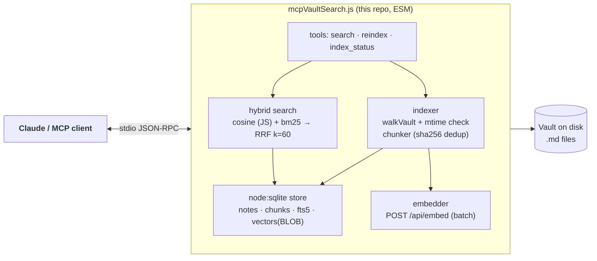

# Vault Search MCP — Plan

Lightweight replacement for the [obsidian-brain](https://github.com/sweir1/obsidian-brain) MCP: **semantic (vector) search over an Obsidian vault + incremental index updates**, nothing else. Read-only over the vault; no note editing, no knowledge-graph analytics, no companion plugin.

Status: **draft for review** — no code written yet.

---

## 1. Why obsidian-brain broke, and what we avoid

obsidian-brain is a well-engineered but heavy TS project (18 tools, graph analytics, plugin handshake). Its runtime dependencies include **three ABI/binary-sensitive packages**:

| Dependency | Role in obsidian-brain | Why it breaks |
|---|---|---|
| `better-sqlite3` | SQLite driver | Native Node addon; every Node major upgrade can require a rebuild (`NODE_MODULE_VERSION` mismatch, `ERR_DLOPEN_FAILED`) — exactly your symptom |
| `@huggingface/transformers` → `onnxruntime-node` | Local embedding model | Ships a native `.node` binary; v4 additionally pulls `sharp` and `@huggingface/tokenizers` (two more native addons) |
| `sqlite-vec` | `vec0` vector tables in SQLite | Platform-specific binary SQLite extension |

All three are replaceable with Node 24 built-ins and a process-external embedding service, at the scale of a personal vault.

## 2. Proposed stack (zero native npm dependencies)

| Layer | Choice | Rationale |
|---|---|---|
| MCP server | `@modelcontextprotocol/sdk` (~1.32.x) + `zod`, stdio transport | Pure JS, ESM, `node >= 18`; `registerTool` + `StdioServerTransport` |
| Embeddings | **Ollama** `POST /api/embed` on `localhost:11434` via built-in `fetch` | Zero npm deps, zero ABI surface, native batch input, `truncate: true` |
| Embedding model | `nomic-embed-text` (768-dim, 8192-token ctx, ~274 MB) default; configurable | Most widely used Ollama embed model; good English retrieval |
| Storage | `node:sqlite` (`DatabaseSync`) — built into Node ≥ 22.13, stability 1.2 in Node 24 | No driver dependency at all |
| Lexical search | FTS5 virtual table (`porter unicode61` tokenizer) | **FTS5 is enabled in Node's bundled SQLite since 24.0.0** (nodejs/node#57621) — confirmed for our ≥ 24.22.1 pin |
| Vector search | Brute-force cosine in JS over pre-normalized `Float32Array` BLOBs | 50k chunks × 768 dims ≈ 150 MB RAM, ~100–200 ms/query worst case — fine for a personal vault; no ANN library needed |
| Hybrid ranking | Reciprocal Rank Fusion, k = 60 (Cormack et al. 2009) | Parameter-free fusion of BM25 + cosine ranks; same scheme obsidian-brain uses |
| Frontmatter | `gray-matter` (already a repo dependency) | Consistent with the rest of this repo |

**Total new runtime npm dependencies: 2** (`@modelcontextprotocol/sdk`, `zod` — and zod is already present transitively via repo overrides). Everything else is `node:sqlite`, `node:fs`, `node:path`, `node:crypto`, global `fetch`.

Node upgrades can no longer break this server: no compiled addons exist to rebuild. Ollama itself is decoupled (its models don't depend on our Node version).

### Rejected alternatives

- **transformers.js local embeddings** — best UX (no external service) but pulls `onnxruntime-node`, `sharp`, `@huggingface/tokenizers`: three native addons, i.e. recreates the exact failure class we're escaping.
- **sqlite-vec via `db.loadExtension()`** (`node:sqlite` supports it; Windows x64 prebuilds exist via `@photostructure/sqlite-vec`) — a SQLite loadable extension is Node-ABI-immune (SQLite loads the DLL itself), so it *is* a safe later option. Deferred: brute force is already fast at personal-vault scale. This is the designated upgrade path if the index ever grows past ~100k chunks.
- **Remote embedding APIs (OpenAI etc.)** — vault content would leave the machine; wrong default for a personal vault.
- **FTS-only (no vectors)** — would be truly zero-external-service, but semantic search is the entire point of the migration. Kept as a graceful degradation mode instead (see §7).

## 3. What we keep from obsidian-brain's design (it did these well)

1. **Chunk-level embeddings, not note-level.** Heading-aware chunker: split on H1–H4, protect fenced code blocks and `$$…$$` LaTeX from being cut, greedy-pack to ~1000 chars (paragraph → sentence → hard-cut fallback), minimum 50 chars, no overlap. Embedding text = `heading + "\n\n" + content`.
2. **Two-level incremental indexing.**
   - File level: `sync` table stores `mtimeMs`; a file whose mtime hasn't increased is skipped entirely (re-scan is O(number of files) `stat` calls — milliseconds even for thousands of notes).
   - Chunk level: each chunk stores a SHA-256 of its text; on re-index of a changed note, unchanged chunks **reuse their stored vectors — no embed call**.
3. **Deletion handling:** paths present in `sync` but absent from a full scan get purged (chunks + FTS + vectors).
4. **Hybrid search:** semantic rank and BM25 rank fused with RRF (k = 60), deduped per note by best chunk.
5. **Model/dim metadata in the DB** (`index_metadata`): on embedding-model or dimension change, wipe vectors and re-embed, but keep chunk text and FTS index intact.

## 4. What we deliberately drop

- Note editing tools, link/graph analytics, PageRank/Louvain, companion plugin, CLI (`models` subcommands, auto-pull, seed-model metadata resolver) — none of it was in your usage pattern.
- **File watcher (chokidar).** Your vault lives in **OneDrive** — file-change events there are notoriously flaky (sync placeholders, rapid attribute churn). Instead: cheap mtime re-scan at server startup + on every `search` call older than N seconds (default 30 s), plus an explicit `reindex` tool. This keeps the dependency list at 2 and matches "incrementally update that index" without a watcher's edge cases. *(Decision point D2 if you want live watching anyway.)*
- Failed-chunk table + token-budget ratchet — over-engineering for Ollama, which handles truncation server-side (`truncate: true`).
- Note-level mean-pooled vectors (obsidian-brain kept them only for backward compat).

## 5. Architecture



### File layout (follows repo conventions)

```
mcpVaultSearch.js          # root entry script (MCP stdio server)
lib/mcp/
  config.js                # env parsing: VAULT_PATH, OLLAMA_*, DB path
  chunker.js               # heading-aware chunker (pure, no I/O)
  embedder.js              # Ollama /api/embed client, batching, dim probe
  store.js                 # node:sqlite schema + all SQL (WAL mode)
  indexer.js               # scan / incremental update / purge / model swap
  search.js                # cosine + FTS5 + RRF fusion, result shaping
  server.js                # McpServer wiring, registerTool, stdio transport
smoke/
  fixture/vault-mcp/       # small deterministic fixture vault (~8 notes)
  stub-ollama.mjs          # local HTTP stub returning deterministic vectors
  verify-mcp.mjs           # end-to-end proof against stub (no real Ollama)
```

### SQLite schema (single DB file, WAL mode)

```sql
CREATE TABLE notes (
  path TEXT PRIMARY KEY,          -- vault-relative, '/'-separated
  title TEXT NOT NULL,            -- frontmatter title ?? basename
  mtime REAL NOT NULL
);
CREATE TABLE chunks (
  id TEXT PRIMARY KEY,            -- "${notePath}::${chunkIndex}"
  note_path TEXT NOT NULL REFERENCES notes(path) ON DELETE CASCADE,
  chunk_index INTEGER NOT NULL,
  heading TEXT,                   -- nearest heading, NULL for preamble
  content TEXT NOT NULL,
  content_hash TEXT NOT NULL,     -- sha256(heading + ' ' + content)
  start_line INTEGER, end_line INTEGER,
  embedding BLOB                  -- packed Float32Array, L2-normalized; NULL while pending
);
CREATE INDEX idx_chunks_note ON chunks(note_path);
CREATE INDEX idx_chunks_hash ON chunks(content_hash);
CREATE VIRTUAL TABLE chunks_fts USING fts5(
  note_path, title, content,
  tokenize = 'porter unicode61'
);
CREATE TABLE meta (key TEXT PRIMARY KEY, value TEXT, updated_at INTEGER);
-- keys: schema_version, embedding_model, embedding_dim, vault_path
```

FTS5 populated directly (contentless-managed by our code — simpler than external-content tables; rows written/deleted alongside chunk rows).

### Incremental update flow

1. `walkVault(vaultPath)` (existing `lib/vault.js` helper — already skips `.obsidian/`, dot-dirs, `node_modules`).
2. For each file: `stat.mtimeMs` ≤ stored mtime → skip. Else parse frontmatter, chunk, hash.
3. New chunks with a hash already stored for that note **keep their embedding BLOB**; only new/changed chunks are collected and sent to Ollama **in batched `/api/embed` calls** (batch ~32 texts).
4. Stale chunks (index ≥ new count, or hash no longer present) deleted; FTS rows synced.
5. Paths in `sync`-equivalent (`notes`) but not on disk → purge.
6. Store model/dim in `meta`; mismatch on startup → clear `embedding` BLOBs + `meta`, require reindex (chunks/FTS survive).

## 6. MCP tool surface (3 tools)

| Tool | Args | Behavior |
|---|---|---|
| `search` | `query` (string), `mode?` `hybrid\|semantic\|fulltext` (default `hybrid`), `limit?` (default 10), `unique?` `notes\|chunks` (default `notes`) | Runs RRF fusion (or single mode). Returns `{path, title, score, excerpt, heading?, startLine?, endLine?}` per hit. Triggers background incremental scan if index stale (> 30 s) |
| `reindex` | `force?` (boolean, default false) | Incremental scan now; `force: true` ignores mtime and re-checks all files (still reuses unchanged chunk hashes). Returns stats: `{scanned, updated, skipped, embedded, purged, totalNotes, totalChunks}` |
| `index_status` | — | `{embeddingModel, embeddingDim, notesTotal, chunksTotal, chunksWithVectors, pendingVectors, lastIndexedAt, vaultPath, stale: bool}` |

All responses JSON text; logs to **stderr only** (stdout is the JSON-RPC channel). Result excerpts: best-matching chunk snippet, ~200 chars.

### Client wiring (Claude Desktop / Claude Code)

```json
{
  "mcpServers": {
    "vault-search": {
      "command": "node",
      "args": ["C:\\Users\\NICHO\\git\\obsidian-utilities\\mcpVaultSearch.js"],
      "env": {
        "VAULT_PATH": "C:\\Users\\NICHO\\OneDrive\\Documents\\Test Vault",
        "OLLAMA_MODEL": "nomic-embed-text",
        "VSMCP_DB_PATH": "C:\\Users\\NICHO\\.vault-search\\index.db"
      }
    }
  }
}
```

### Env vars

| Var | Default | Notes |
|---|---|---|
| `VAULT_PATH` | *(required)* | Absolute path to vault |
| `OLLAMA_URL` | `http://localhost:11434` | |
| `OLLAMA_MODEL` | `nomic-embed-text` | Any Ollama embed model; dim probed at first use |
| `VSMCP_DB_PATH` | `<repo>/.data/vault-search.db` | Keep out of the vault (avoids OneDrive sync of a hot WAL DB) |
| `VSMCP_RESCAN_INTERVAL_MS` | `30000` | Auto incremental-scan cadence on `search` |

## 7. Failure modes & degradation

- **Ollama not running / unreachable:** startup and `reindex` report it clearly; `search` in `hybrid`/`semantic` mode falls back to `fulltext` with a `"degraded"` note in the response; `fulltext` mode always works (FTS5 needs no Ollama). Partial index (some chunks un-embedded) simply scores what it has.
- **Model/dimension change:** vectors wiped, text + FTS preserved, `reindex` re-embeds only (chunk hashes don't change → full-text side untouched).
- **Vault on OneDrive:** mtime scans tolerate sync quirkiness; DB lives outside the vault by default.
- **Concurrent runs:** WAL + `busy_timeout` via `node:sqlite`; a single in-process queue serializes index writes.

## 8. Testing & verification plan

1. **Unit-ish smoke (deterministic, no network):** `smoke/verify-mcp.mjs` boots the MCP server as a child process against `smoke/fixture/vault-mcp/` with `OLLAMA_URL` pointed at `smoke/stub-ollama.mjs` (deterministic hash-based vectors, records batch calls). Asserts, via real MCP stdio JSON-RPC: tool discovery, first index (`reindex` → stats), incremental behavior (touch one file → only that note re-embedded; add file → indexed; delete file → purged), `search` hybrid ranking sanity (stub vectors make a known note win), fulltext-only fallback with stub stopped. Pattern mirrors the existing `confluence-stub-proc.mjs` / `gcs-stub.mjs` approach.
2. **Real run against your Test Vault** (manual, after Ollama install): seed the vault with a handful of topical test notes (we'll generate these — e.g. cooking, woodworking, Kotlin, meeting notes — with overlapping vocabulary to prove semantic beats keyword), run `node mcpVaultSearch.js` with MCP Inspector (`npx @modelcontextprotocol/inspector`), exercise all 3 tools, verify a semantic query returns the right note where FTS alone wouldn't.
3. **Perf sanity:** time one full index + one hybrid search on the Test Vault; record numbers in the plan's delivery note.
4. Repo hygiene: `README.md` gets a "Vault Search MCP" section; package.json gains the two deps and a `verify:mcp` script (or extends `npm run verify`).

## 9. Build order

1. `lib/mcp/chunker.js` + fixture vault + stub Ollama (pure pieces, testable immediately)
2. `store.js` schema + `indexer.js` incremental logic → prove via throwaway script against fixture
3. `embedder.js` + wiring → prove against real Ollama on Test Vault
4. `search.js` fusion → prove ranking with stub + real model
5. `server.js` + root entry → MCP Inspector proof, then Claude config
6. `smoke/verify-mcp.mjs` hardened into the regression suite; README section

## 10. Open decision points (need your call before execution)

- **D1 — Ollama install (prerequisite).** The recommended embedding path needs Ollama installed and running (`ollama pull nomic-embed-text`, one-time ~274 MB + ~1 GB app). It's not on this machine today. Options:
  - (a) Install Ollama — zero native deps, private, batch embeds *(recommended)*
  - (b) Ship FTS-only first, add Ollama later — works today, no semantic search (defeats the primary goal short-term)
  - (c) Remote embedding API — no local service, but note content leaves the machine
- **D2 — Live watcher.** Default plan: mtime re-scan (30 s cadence + startup + explicit `reindex`). Alternative: add chokidar (pure JS, 1 dep) for event-driven updates — but OneDrive event reliability is questionable, which is why the scan approach is recommended.
- **D3 — DB location.** Default `<repo>/.data/` (gitignored). Alternative: `%LOCALAPPDATA%` to keep it fully out of the repo.
- **D4 — Model choice.** Default `nomic-embed-text` (768-d). If your notes are meaningfully multilingual, `bge-m3` (1024-d, ~1.2 GB) is the better default.
- **D5 — Extra tools?** `read_note` (fetch full note by path) is cheap and pairs naturally with `search` results. Plan currently excludes it to stay minimal; say the word and it's a ~20-line addition.

## 11. Sources

- obsidian-brain internals: `src/store/db.ts`, `src/pipeline/indexer/index.ts`, `src/embeddings/chunker.ts`, `src/search/unified.ts` (v1.7.24) — schema, mtime/hash two-level incrementality, chunker rules, RRF k=60 fusion
- Node 24 `node:sqlite`: stability 1.2, BLOB/TypedArray support, `allowExtension`/`loadExtension` — https://nodejs.org/download/release/latest-v24.x/docs/api/sqlite.html
- FTS5 in Node's bundled SQLite since 24.0.0 — https://github.com/nodejs/node/pull/57621
- Ollama batch embed API — https://docs.ollama.com/api/embed
- transformers.js native deps (why excluded) — https://registry.npmjs.org/@huggingface/transformers/latest, https://huggingface.co/docs/transformers.js/api/backends/onnx
- MCP SDK (pure JS, `registerTool`, stdio) — https://registry.npmjs.org/@modelcontextprotocol/sdk/latest
- RRF (Cormack, Clarke, Buettcher 2009, k = 60)
- sqlite-vec prebuilt fork (deferred upgrade path) — https://registry.npmjs.org/@photostructure/sqlite-vec/latest
